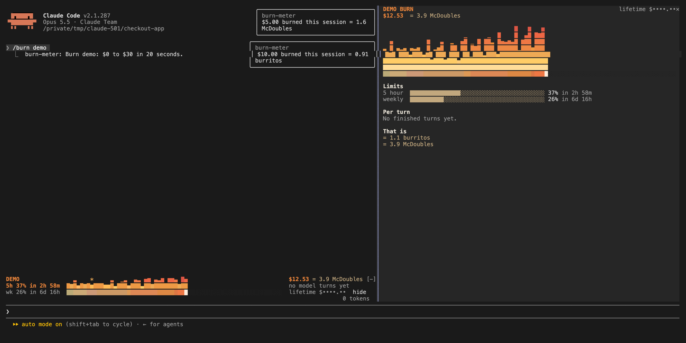

# burn-meter

Live session cost odometer above the prompt: a burning fuse, threshold alerts, and the status line's figures, in Chinese.



A band above the prompt. Its top row carries the status line's figures: model, folder, git branch, context use, session time, lines changed and output style. Below it, once the session has spent something, a growing fire bar for session spend, 5-hour and weekly plan-limit bars with reset times, and token use by model. `/burn` opens the full panel with the same figures and per-turn cost. Alerts fire when you cross a threshold. Every label is in Chinese.

(The screenshot shows the original English version.)

## What the hooks do

Everything burn-meter shows comes from the session's own numbers, which Claude Code reports to the mod, plus `git status` for the branch. It never reads your files, your environment variables or your credentials, and never sends anything off your machine. "Tokens" on this page always means model token counts, not login tokens.

- `session.start`: draws the band, registers `/burn`, and reads the branch and output style.
- `tool.call` for `Edit` and `Write`: after the tool has run, counts the `+` and `-` lines in its diff for the lines-changed figure. It does not change the call or its result.
- `prompt.submit`: notes the session's cost at the moment you send a prompt, so it can show what that turn cost. It does not read or change the prompt, and passes it through untouched.
- `turn.complete`: adds the finished turn's token counts and cost to the per-turn chart, shows a toast when spend crosses a threshold, and rereads the branch.
- `command.run` for `/burn`: opens the pane or toggles the band.
- `ui.render`: draws the band above the prompt and the `/burn` pane.

It runs one command, `git --no-optional-locks status --porcelain=v2 --branch`, in the session's folder: at session start, after each turn, and every 30 seconds. It is read-only and takes no locks. It reads the `outputStyle` setting to name the output style.

It stores two small values with Claude Code's own plugin storage: your running lifetime spend, and the last cost reading for the current session so a restart does not count the same spend twice.

## Install

In a Claude Code session (2.1.287 or later):

```
/plugin marketplace add invictuskai/claude-plugins
/plugin install burn-meter@oceanus-plugins
```

Or load this folder for one session: `claude --plugin-dir ./burn-meter`

## What it reaches

| Mod | Network | Runs processes | Files | Calls a model | Sends data anywhere |
| --- | --- | --- | --- | --- | --- |
| burn-meter | No | `git status` (read-only) | No | No | No |

Run `claude plugin validate ./burn-meter` to list every event it hooks and every call it makes. See the [repository README](https://github.com/OneWave-AI/claude-code-mods#security) for the full security notes.

Forked from [claude-code-mods](https://github.com/OneWave-AI/claude-code-mods) by [OneWave AI](https://www.onewave-ai.com) (commit `e6da26c`), with the palette changed to match the Ayu Dark theme, the status line's figures added, and the text translated into Chinese. MIT licensed.
